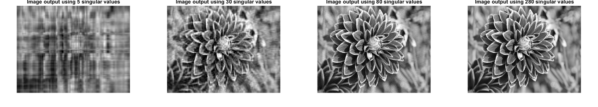
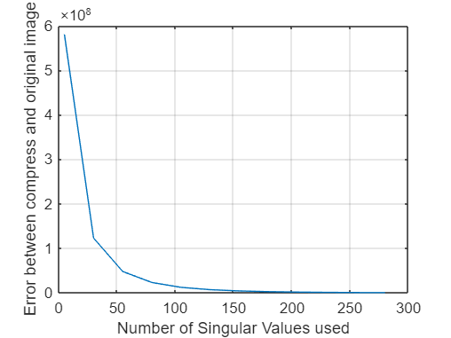
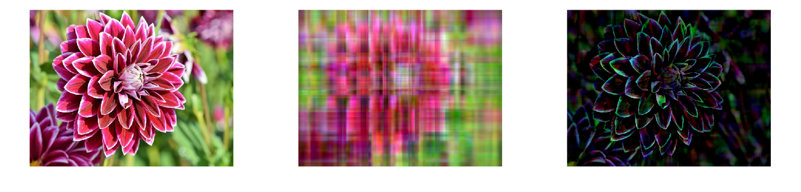
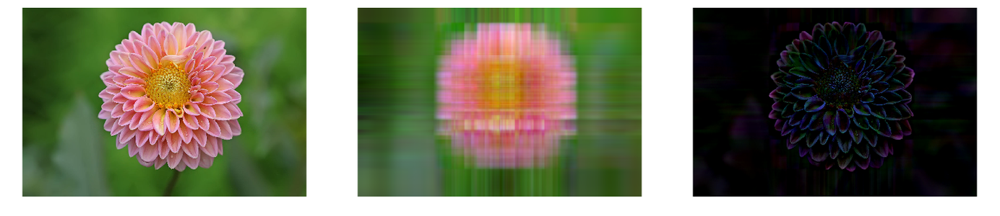

# Image Processing Using SVD in MATLAB

Image compression with the **Singular Value Decomposition (SVD)**, implemented as MATLAB Live Scripts. A low-rank approximation keeps only the *k* largest singular values of an image, which stores far less data while preserving most of the visual content.


> Course project for *Mathematics for Intelligent Systems* (21MAT117), Amrita School of Engineering, under the guidance of Dr. Sarada Jayan.

## Results

### Grayscale: reconstruction quality vs. number of singular values

The grayscale script reconstructs the image with *k* = 5, 30, 55, …, 280 singular values. Panels below show *k* = 5, 30, 80 and 280.



The squared reconstruction error falls steeply over the first few dozen singular values and then flattens, which is why a small *k* already looks close to the original.



### Color: per-channel SVD (original, rank-4 reconstruction, absolute difference)

Each of the R, G and B channels is decomposed separately and rebuilt from its top 4 singular values.

`flower.jpg`:



`dahlia.jpg`:



*All figures are exported from the saved outputs of the Live Scripts in [`matlab/`](matlab).*

## How it works

Any image channel can be treated as an `m × n` matrix **A**. Its SVD is

$$A = U \Sigma V^{T}$$

where `U` and `V` have orthonormal columns and `Σ` is diagonal with singular values `σ₁ ≥ σ₂ ≥ … ≥ 0`. Keeping only the first *k* terms gives the best rank-*k* approximation of **A** in the least-squares sense (Eckart–Young theorem):

$$A_k = \sum_{i=1}^{k} \sigma_i \, u_i v_i^{T}$$

Storing `A_k` needs `k(m + n + 1)` numbers instead of `m·n`. For the 500 × 650 grayscale test image that is about **1.8 %** of the original at *k* = 5, **10.6 %** at *k* = 30 and **28.3 %** at *k* = 80 (theoretical figures from the formula, not measured file sizes).

Core of the grayscale script:

```matlab
[U, S, V] = svd(double(grayImage));
C = S;
C(N+1:end, :) = 0;      % keep only the N largest singular values
C(:, N+1:end) = 0;
D = U * C * V';         % low-rank reconstruction
err = sum(sum((double(grayImage) - D).^2));
```

## Repository structure

```
.
├── matlab/
│   ├── svd_grayscale_compression.mlx      # grayscale sweep over k, error plot
│   ├── svd_color_compression_flower.mlx   # per-channel RGB SVD on flower.jpg
│   ├── svd_color_compression_dahlia.mlx   # per-channel RGB SVD on dahlia.jpg
│   ├── flower.jpg                         # test image (650 × 500)
│   └── dahlia.jpg                         # test image (1200 × 800)
└── docs/
    ├── project-report.docx                # full project report
    ├── presentation.pptx                  # project slides
    ├── results/                           # figures used in this README
    └── references/
        └── sadek-2012-svd-image-processing.pdf
```

## Scripts

| Script | Input | What it does |
|---|---|---|
| `svd_grayscale_compression.mlx` | `flower.jpg` → grayscale | Reconstructs the image for *k* = 5:25:300, shows each result and plots squared error against *k*. |
| `svd_color_compression_flower.mlx` | `flower.jpg` | Runs SVD on R, G, B separately, rebuilds with `Blocksize` singular values, shows original / reconstruction / absolute difference, and computes PSNR and a storage ratio. |
| `svd_color_compression_dahlia.mlx` | `dahlia.jpg` | Same pipeline as above on a larger image. |

## Getting started

**Requirements**

- MATLAB R2016a or newer (Live Scripts, `.mlx`)
- Image Processing Toolbox (`imshow`, `psnr`)

**Run**

1. Clone the repository:
   ```bash
   git clone https://github.com/Siddhartha80/image-processing-using-svd-in-matlab.git
   ```
2. In MATLAB, set the current folder to `matlab/` (the scripts load `flower.jpg` / `dahlia.jpg` from there).
3. Open a `.mlx` file and click **Run**.

To change the compression level, edit `N` in the grayscale script or `Blocksize` in the color scripts. Smaller values compress more and lose more detail.

## Notes and known limitations

These are observations from reading the current code; the algorithms were left unchanged.

- The color scripts zero `S(Blocksize+1:125, Blocksize+1:125)`. The `125` is hard-coded and does not match the image sizes, and the step is redundant because only the first `Blocksize` columns are used afterwards.
- The storage ratio `CR` is computed with `whos` on double-precision arrays and with `SS = S1(:, 1:Blocksize)` (an `m × k` slice rather than the `k × k` block), so it is only a rough estimate and is not a standard compression ratio.
- The project report also describes SVD-based face recognition as background theory, but no face-recognition code is included in this repository.
- The report lists `Blocksize = 64` in its color example, while the saved scripts use `Blocksize = 4`.

## Documentation

- [Project report](docs/project-report.docx)
- [Presentation slides](docs/presentation.pptx)

## References

1. R. A. Sadek, "SVD Based Image Processing Applications: State of the Art, Contributions and Research Challenges," *International Journal of Advanced Computer Science and Applications (IJACSA)*, vol. 3, no. 7, 2012. ([copy in this repo](docs/references/sadek-2012-svd-image-processing.pdf))
2. H. C. Andrews and C. L. Patterson, "Singular value decompositions and digital image processing," *IEEE Trans. Acoustics, Speech, and Signal Processing*, vol. ASSP-24, pp. 26–53, 1976.
3. J. L. Kamm, "SVD-Based Methods for Signal and Image Restoration," PhD thesis, 1998.
